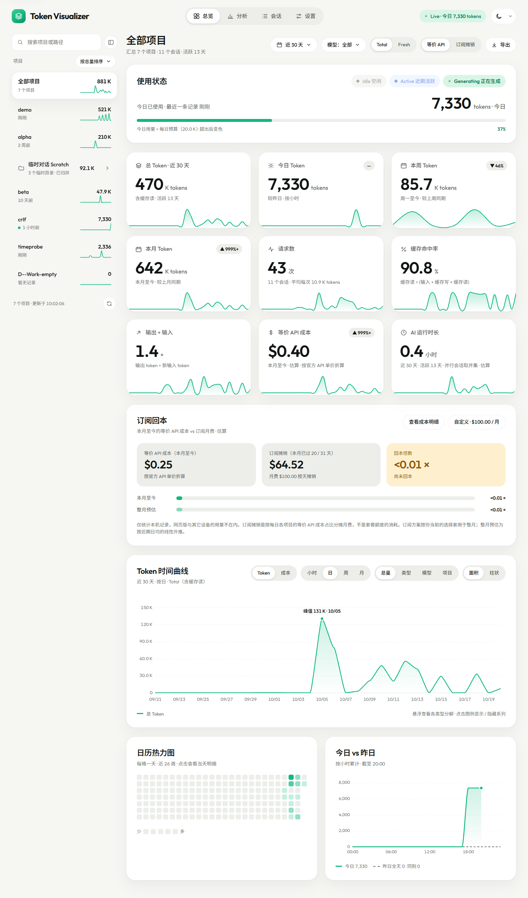

<p align="center">
  
</p>

<h1 align="center">Token Visualizer</h1>

<p align="center">
  A local, read-only dashboard for your Claude Code token usage and estimated API cost.
</p>

<p align="center"><b>English</b> · <a href="README.zh-CN.md">简体中文</a></p>

<p align="center">
  
</p>

Token Visualizer reads the session logs Claude Code writes to `~/.claude/projects`, counts tokens per project, and shows totals, trends, and breakdowns by model, tool, cache and session. It also converts usage into an "equivalent API cost" at official prices and compares it with your subscription fee.

[Features](#features) · [Quick start](#quick-start) · [Configuration](#configuration) · [Development](#development) · [How it works](#how-it-works)

> [!NOTE]
> The interface is currently in Chinese only. This README is in English; the [Chinese README](README.zh-CN.md) is the full reference.

## Features

- **Overview**: today / week / month usage, request count, cache hit rate, equivalent API cost, estimated AI run time, subscription payback, token timeline, and a 26-week calendar heatmap.
- **Analysis**: token type breakdown, model ranking, cache efficiency, active hours, tool usage, project comparison, main thread vs. subagents.
- **Sessions**: sortable and searchable table with per-request detail and context growth curves.
- **Cost**: equivalent API cost, or your subscription fee amortized across projects and sessions.
- **Export**: CSV / JSON for daily, per-model, and per-session data.
- **Live**: incremental refresh, so new activity shows up within seconds. Light and dark themes.

## Privacy

- **Read-only**: never modifies anything under `~/.claude`. Its own cache and settings go to a separate app data folder.
- **No conversation content**: only usage and metadata fields are extracted.
- **No network**: listens on `127.0.0.1` only and makes no outbound requests at runtime. Fonts and icons are bundled.

## Install

### Desktop app (Windows, recommended)

No Node.js and no browser needed. Download from the [Releases](../../releases) page:

- `Token-Visualizer-Setup-<version>.exe`: installer (choose the install folder; adds desktop and Start menu shortcuts).
- `Token-Visualizer-<version>-portable.exe`: portable build, just double-click.

It opens in its own window and quits when you close it. The desktop app and the command-line version share the same settings and cache (`%APPDATA%\TokenVisualizer`), and uninstalling does not delete them.

> [!NOTE]
> The installers are **not code-signed**, so Windows SmartScreen may show "Unknown publisher" on first run: click "More info" → "Run anyway". Release notes list SHA-256 checksums, and you can build the app yourself from source (see [Development](#development)).
> Only Windows 11 has been tested. macOS and Linux are untested.

## Quick start (browser version)

**Requirements:** Windows 11 and Node.js >= 22.18. The server has no third-party runtime dependencies.

### From a release

1. Download `token-visualizer-<version>.zip` (the source archive) from the [Releases](../../releases) page and unzip it.
2. Double-click `start.cmd` (or run `node src/server/index.ts`).
3. Your browser opens at `http://127.0.0.1:47821/`. If the port is busy, the next free one is used.

### From source

```bash
git clone https://github.com/ELjagi623/token-visualizer.git
cd token-visualizer
npm install      # only needed to rebuild the frontend or run tests
npm start
```

The prebuilt frontend is committed in `web/dist`, so you can skip `npm install` if you just want to run it. Use `npm start -- --no-open` to avoid opening the browser.

The first launch parses all session files (about 2 seconds for 700 MB of logs); later launches read from a cache.

## Configuration

Most options live in the in-app Settings page: data folder, time zone, theme, refresh interval, model prices, subscription plan, and budgets. Environment variables:

| Variable | Description |
|---|---|
| `TV_DATA_ROOT` | Session log folder. Default: `%USERPROFILE%\.claude\projects` |
| `TV_APPDATA_DIR` | Cache and settings folder. Default: `%APPDATA%\TokenVisualizer` |
| `TV_PORT` | Starting port. Default: `47821` |
| `TV_NO_OPEN=1` | Do not open the browser on start |

## Development

```bash
npm run dev:web      # Vite dev server (run `npm start -- --no-open` in another terminal)
npm run build        # rebuild web/dist
npm test             # unit tests
npm run typecheck    # TypeScript checks
npm run test:e2e     # Playwright end-to-end tests
npm run acceptance   # automated acceptance against synthetic fixtures
```

Desktop app (Electron):

```bash
npm run app            # build, then run in a standalone window
npm run dist           # build the Windows installer and portable exe into release/
npm run smoke:desktop  # launch the real window and check rendering, sandbox, single instance, shutdown
```

The desktop shell lives in `desktop/`. The Electron main process starts the existing local server in-process and loads `http://127.0.0.1:47821` in a sandboxed window; esbuild bundles the server into one file, so the packaged app does not need Node.js. To change the icon, replace `desktop/icon.png`.

The stack is Node (native TypeScript), Vite, React 18, Zustand and ECharts, packaged with Electron for the desktop app.

## How it works

> [!IMPORTANT]
> All costs are **estimates**, not bills. Prices were checked against official pages on 2026-11-10 and can be updated in Settings. Only usage recorded on this machine is counted; web or other-device usage is not included.

- Messages are deduplicated globally by message ID, since Claude Code can write the same message several times.
- `Total = input + cache write + cache read + output`; `Fresh` excludes cache reads.
- Models not starting with `claude-` are treated as local models and are not priced.

See the [Chinese README](README.zh-CN.md) for the full details on cost methodology, data semantics, caching, the HTTP API, known limitations, and troubleshooting.
